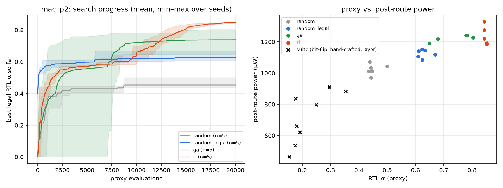
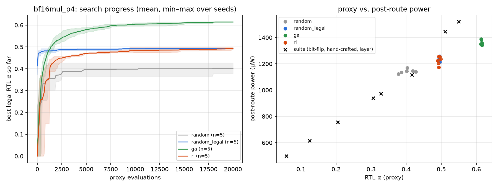
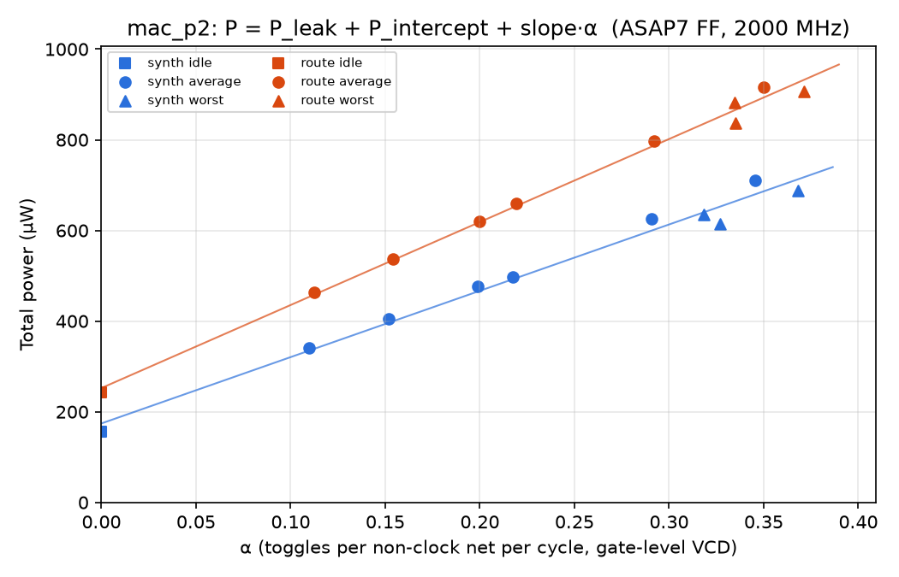
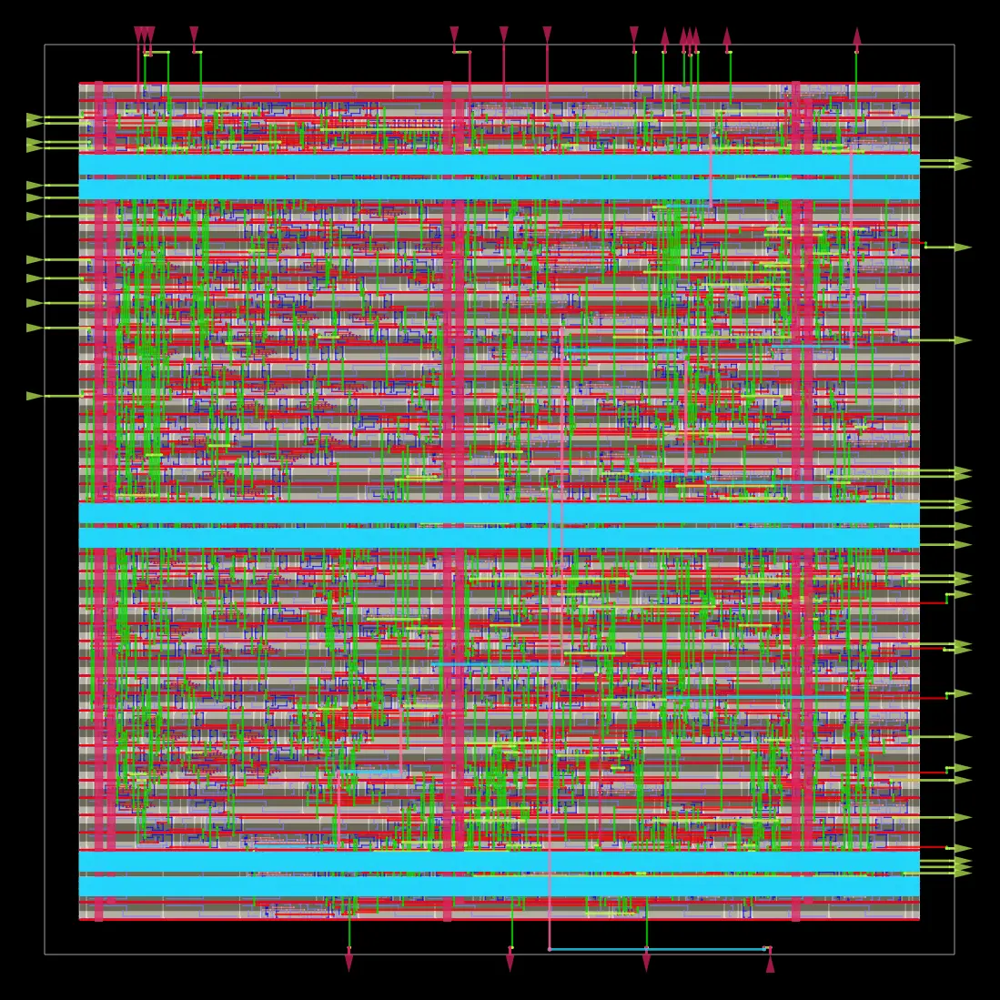
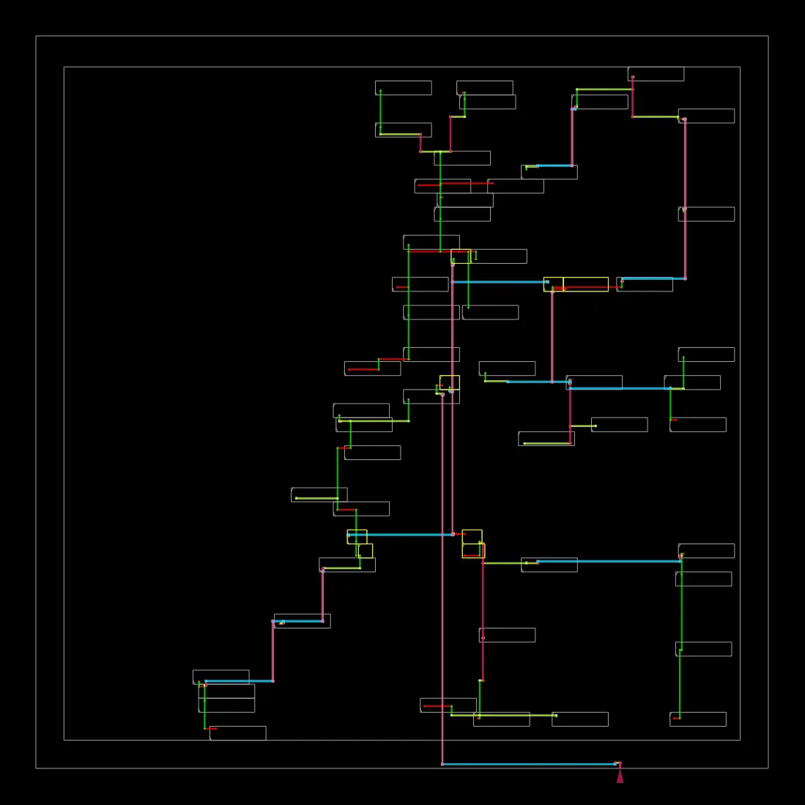

# xls-power-rl

Physically aware power models and worst-case (power-virus) activity search for XLS-generated ML-accelerator blocks, from RTL to post-route on ASAP7, using only open-source tools.

**Highlights** (every number is traceable to a run; see [docs/decisions.md](docs/decisions.md)):
- **Power models across abstraction levels.** Leakage, intercept and slope fitted from gate-level VCD at synthesis and post-route for three blocks. The clock tree raises the activity-independent term by **45–113%** after routing; wiring raises the slope by 12–25%.
- **RL vs. GA vs. CEM vs. random vs. an LLM policy for worst-case power,** under fail-closed validity gates with a logged reward-hacking record, validated post-route.
  - Among search methods (20k evaluations each), RL wins on the stateful INT8 MAC and CEM on the stateless bf16 multiplier and the 4×4 matrix engine.
  - **Claude as a policy** (reads the RTL, then searches with ≤256 evaluations) **finds the most post-route power in all four configurations**, 3–26% above the best search method. This is one run per configuration.
- **Proxy rewards can be gamed, and calibration fixes it.** Searching on an RTL toggle proxy leaves 6–12% top-pick regret against post-route power. An exactly calibrated gate-level proxy brings regret to 0% and finds 8–12% more power, at 10× the evaluation cost.
- **Silent failures caught by fail-closed checks,** each documented: OpenSTA ignoring a stopped clock in VCD, XLS array bit order, XLS subnormal rounding, and a constant-product test pattern.

## Quick start

Requires Linux or WSL2 (Ubuntu 24.04), Python ≥ 3.11 and Docker. Full setup: [docs/setup.md](docs/setup.md).

```bash
# Python harness and unit tests (no EDA tools needed)
python3 -m venv .venv && .venv/bin/pip install -e ".[dev,rl,plots]"
.venv/bin/pytest -q

# Toolchain: XLS release in ~/opt/xls, apt install verilator iverilog,
# docker pull openroad/orfs:latest (versions pinned in docs/setup.md)

# One block end to end: DSLX -> Verilog -> ORFS (ASAP7) -> VCD power model
python scripts/build_block.py mac 2                                   # writes ~/runs/mac/p2
CLK_PERIOD_PS=500 scripts/orfs_run.sh ~/runs/mac/p2/mac_p2.v mac_p2   # about 2 min
python scripts/vcd_power.py --block mac --top mac_p2                  # fit + plot

# Worst-case search on the calibrated gate proxy, then post-route validation
python scripts/proxy_calibrate.py --block mac --top mac_p2 --level synth
python scripts/search.py --block mac --top mac_p2 --proxy-level synth --seeds 0 1 2 3 4
python scripts/validate_search.py --block mac --top mac_p2 --config mac_p2_gate
```

Run scripts with `PYTHONPATH=src`, or after `pip install -e .`.

## Model

```
P(α) = P_leak + P_intercept + slope · α
```

| Term | Meaning | Measured from |
|---|---|---|
| `P_leak` | Static power | Clock stopped |
| `P_intercept` | Activity-independent dynamic (clock tree, flops, idle logic) | Clock on, inputs held, valid low |
| `slope` | Dynamic power per unit switching activity | Average and worst-case stimulus |

α is the mean toggle rate per net per cycle inside the measurement window.

## Blocks

| Block | Source | Original or stock |
|---|---|---|
| INT8 MAC | DSLX function + proc with accumulator | Original (ref: `xls/examples/dot_product.x`) |
| bf16 multiplier | `stdlib/bfloat16.x` `mul()` + streaming proc wrapper | Stock XLS datapath; wrapper original |
| Fixed-point exp2 (softmax) | `stdlib/fixed_point.x` | Original |
| INT8 4×4 matmul | Adapted from `xls/examples/matmul_4x4/matmul_4x4.x` (FP32 systolic proc network): INT8, single weight-stationary proc, reloadable weights | Original adaptation of a stock example; see decisions.md |

## Worst-case search: RL vs. GA vs. random

All methods search the same space: a period-8 pattern of full input-port vectors {`rst`, `valid`, data}, repeated after reset. The budget is 20,000 proxy evaluations per run, with 5 seeds. The proxy is RTL toggle rate from a Verilator model; it matches the Icarus VCD measurement exactly and costs about 1 ms per evaluation. Scoring is fail-closed: driving `rst`, never asserting `valid`, a stalled handshake, or (in finite-only mode) Inf/NaN operands all score 0 and go to a reward-hacking log. Each seed's winners are then re-simulated at gate level and run through post-route `report_power`, with the same gates and reference check as every other stimulus. All 72 validated candidates passed.

| Block (ASAP7, 2 GHz) | random | random_legal | GA | RL | best hand-written / suite |
|---|---|---|---|---|---|
| **MAC**: proxy α (mean ± sd) | 0.454 ± 0.026 | 0.627 ± 0.024 | 0.738 ± 0.070 | **0.846 ± 0.005** | 0.353 |
| **MAC**: best post-route power | 1072 µW | 1153 µW | 1242 µW | **1329 µW** | 915 µW |
| **bf16 p4, any input**: proxy α | 0.402 ± 0.021 | 0.494 ± 0.002 | **0.614 ± 0.001** | 0.494 ± 0.004 | 0.550 |
| **bf16 p4, any input**: best post-route power | 1168 µW | 1258 µW | 1389 µW | 1256 µW | **1521 µW** (`alt_0_ffff`, NaN path) |
| **bf16 p4, finite only**: proxy α | 0.402 ± 0.021 | 0.494 ± 0.002 | **0.608 ± 0.010** | 0.490 ± 0.007 | 0.511 |
| **bf16 p4, finite only**: best post-route power | 1168 µW | 1258 µW | 1360 µW | 1258 µW | **1446 µW** (`alt_maxham_normal`) |




- **MAC: RL wins on both the proxy and real power.** It is also the most consistent method (proxy sd 0.005 across seeds, against 0.070 for the GA). Its best pattern draws 1329 µW post-route: 7% above the GA, and 45% above the best hand-written or random-bit-flip stimulus. The MAC has state (the accumulator and the timing of `last`), so input order matters, which is the kind of structure a sequential policy can use.
- **bf16: RL fails, and does no better than random over legal inputs.** The GA leads on the proxy. One hypothesis: the policy samples each bit of a vector independently given its hidden state, so it cannot represent the correlated bit patterns that matter in a stateless datapath. GA crossover keeps those patterns intact. This is untested.
- **On bf16, every search method loses to a hand-written pattern in real power, because the proxy is gamed.** The GA's winners score RTL α 0.61 but reach only 0.45–0.47 gate α. The hand-written alternating patterns score lower on the proxy (0.51–0.55) but their gate α is just as high (0.53–0.55). Power per unit of gate α is similar for both, so the error lies in how RTL activity maps to gate activity, not in how gate activity maps to power.
- **The proxy ranks well overall, but its top pick is wrong.** Spearman correlation between RTL α and post-route power is 0.93 (MAC), 0.94 (bf16) and 0.97 (bf16 finite) over about 32 points each, yet the proxy's top pick costs 6–12% of the true best. For worst-case search the top of the ranking is what matters. Synth-level power ranks post-route power almost perfectly (ρ ≈ 0.995).
- **Reward hacking is common and fully logged.** Plain `random` drives `rst` in 99.6% of its candidates. RL and the GA learn to avoid it, but still try reset toggling 1,400–9,000 times per run. Every rejected attempt that beat the legal best is in `*.rejects.jsonl`.

### Gate-level proxy: calibrating the reward fixes the gaming

The same search was repeated with the proxy computed on the **synthesized netlist** (Verilator plus ASAP7 cell models). This proxy also matches Icarus exactly: |Δα| = 0 on every suite stimulus, 910 bits for the MAC and 964 for bf16. It costs about 10 ms per evaluation, against 1 ms for the RTL proxy.

| Config | Proxy | ρ(proxy α, post-route power) | Regret of the proxy's top pick | Best post-route power found |
|---|---|---|---|---|
| MAC | RTL | 0.926 | 10.7% | 1329 µW (RL) |
| MAC | gate | **0.996** | **0.0%** | **1444 µW** (RL; GA 1383) |
| bf16, any input | RTL | 0.935 | 11.7% | 1389 µW (GA) < hand-written 1521 |
| bf16, any input | gate | **0.995** | **0.0%** | 1495 µW (GA; RL 1405). The proxy correctly ranks the hand-written NaN pattern (1521) first. |
| bf16, finite only | RTL | 0.972 | 6.3% | 1360 µW (GA) < hand-written 1446 |
| bf16, finite only | gate | **0.988** | **0.0%** | **1482 µW (GA) > hand-written 1446** |

- With the gate proxy, every method finds 8–12% more post-route power, and regret falls to zero in all three configurations.
- The method ranking holds: RL on the stateful MAC, the GA on the stateless multiplier. On bf16, RL now clearly beats random_legal (1405 against 1267 µW).

### All methods, including an LLM policy, validated post-route

Every method searched the same space through the same fail-closed scorer on the gate-level proxy. The exception is matmul4, where the search methods used the RTL proxy and then re-scored their top 20 at gate level, because a full gate-level search there would take about 13 hours. Each method's winners were then re-simulated at gate level, checked against the reference model, and measured with post-route `report_power`. All 162 validated candidates passed.

| Best post-route power | random_legal | GA | CEM | RL | RL, joint bits | **LLM policy** | best hand-written |
|---|---|---|---|---|---|---|---|
| INT8 MAC (2 GHz) | 1221 µW | 1383 | 1427 | 1444 | 1273 | **1485** | 915 |
| bf16 mul, any input (2 GHz) | 1267 | 1495 | 1598 | 1405 | 1350 | **1680** | 1521 |
| bf16 mul, finite only | 1267 | 1482 | 1608 | 1280 | 1289 | **1670** | 1446 |
| INT8 4×4 matvec (1.67 GHz) | 8264 | 9112 | 9836 | 8788 | (not run) | **12395*** | 9365 |
| *evaluations per run* | 20k × 5 seeds | 20k × 5 | 20k × 5 | 20k × 5 | 20k × 5 | **≤256 × 1** | |

**LLM policy** ([scripts/llm_env.py](scripts/llm_env.py)):
- Setup: a fresh Claude Opus agent gets a task folder containing only the block's RTL and a spec (interface, objective, rules, candidate format). It scores candidates only through the budgeted, fail-closed scorer, and has no access to other methods' results.
- What the agents worked out from the RTL:
  - MAC: alternate `last` so the accumulator swings between 0 and −1.
  - bf16: period 2 is optimal for a stateless pipeline; alternate the mantissas 0x00 ↔ 0x7F for full partial-product toggling, and tune the exponent sums for long carry chains.
  - matmul4: weights at −1 and all lanes swinging ±1 in phase.
- The matmul4 agent also wrote its own surrogate model of the RTL to plan candidates offline.
- Caveat: one run per configuration so far. An API-driven, multi-sample, pinned-model rerun is the next step.

\***The matmul4 winner does no useful work.** Every word is a weight load: the XLS datapath multiplies and registers on every cycle, even during loads, and discards the result (no operand isolation). That is legal under the current gates and physically real, which makes it a design-quality finding in itself. It is a different category from "worst case while computing": the best stimulus that requests computation is CEM's 9836 µW. A "useful work" gate is planned to report both cleanly.

**The independent-bit hypothesis for RL on bf16 is refuted.**
- CEM samples every bit independently, yet beats RL on bf16 by 14–26%.
- An RL policy that samples bits jointly (autoregressively within each word) does no better (1350 against 1405 µW), and worse on the MAC (1273 against 1444).
- RL's bf16 weakness is therefore in how it learns from a sparse, rejection-heavy reward, not in what it can represent.

**Proxy fidelity holds:** ρ(gate proxy, post-route power) = 0.987–0.995, with 0–2.7% top-pick regret.

Prior work: [docs/prior-art.md](docs/prior-art.md). The GA lineage for power viruses goes back to 1997. No RL power-virus work was found.

Reproduce (in WSL):

```bash
python scripts/proxy_calibrate.py --block mac --top mac_p2      # proxy == Icarus RTL alpha
python scripts/search.py --block mac --top mac_p2 --seeds 0 1 2 3 4 --budget 20000
python scripts/validate_search.py --block mac --top mac_p2      # gate-level + post-route
```

## Results so far: synth → post-route, per block

All runs use ASAP7 FF NLDM, and timing is met post-route. Power comes from gate-level VCD of each level's own netlist, so α is measured, not assumed. Energy per cycle (pJ) puts blocks at different clocks on the same footing.

| Block | Stages @ clock | Area (µm²) | Intercept synth → route | Slope synth → route | Idle pJ/cycle (route) | Synthetic-layer pJ/op (route) |
|---|---|---|---|---|---|---|
| INT8 MAC | 2 @ 2 GHz | 95.3 | 174 → 252 µW (**+45%**) | 1463 → 1831 µW/α (+25%) | 0.121 | 0.330 |
| bf16 mul | 2 @ 1 GHz | 80.6 | 50 → 107 µW (**+113%**) | 675 → 831 µW/α (+23%) | 0.110 | 0.331 |
| bf16 mul | 4 @ 2 GHz | 104.1 | 225 → 404 µW (**+80%**) | 1666 → 2004 µW/α (+20%) | 0.207 | 0.470 |
| INT8 4×4 matvec | 3 @ 1.67 GHz | 880.6 | 941 → 1799 µW (**+91%**) | 13546 → 15189 µW/α (+12%) | 1.097 | 2.459 |

- **The clock tree drives the intercept, and how much depends on the design.** CTS raises the intercept 45–113%, while wire capacitance raises the slope a steadier 20–25%.
- **Depth costs energy.** Going from 2 to 4 stages lets the bf16 multiplier run twice as fast, but costs 29% more area, about 2× the idle energy per cycle, and 42% more energy per multiply on the synthetic layer.
- **The RTL toggle rate is an imperfect proxy.** For the MAC, `alt_0_ff` has RTL α 0.18 but gate α 0.33, while `alt_55_aa` goes the other way. bf16 tracks more closely. Phase 5 quantifies this: the RL reward uses RTL α.
- **XLS's ASAP7 delay model is about 1.5× pessimistic against ORFS at the FF corner.** For the MAC at 2 stages it estimates 732 ps; ORFS closes at about 493 ps.

Plots: [MAC](docs/img/mac_p2_power_fit.png) · [bf16 p2](docs/img/bf16mul_p2_power_fit.png) · [bf16 p4](docs/img/bf16mul_p4_power_fit.png)

## bf16 multiplier: notes

Stock `bfloat16::mul` behind an original streaming wrapper ([designs/bf16_mul/bf16_mul.x](designs/bf16_mul/bf16_mul.x)). Gate-level outputs at every level are checked against a Python model of XLS's semantics:

- Subnormal inputs are treated as zero, and rounding is round-to-nearest-even only. NaN outputs are always `0x7FC0`.
- **Found on the RTL, not in the doc comment:** products below the normal range are rounded at subnormal precision first and flushed only if they are still subnormal. So (255/256)·2⁻¹²⁶ comes out as the min normal `0x0080`, not 0. `scripts/bf16_edge_probe.py` checks a 441-pair boundary grid; it found 4 mismatches against the doc-comment model and 0 after the fix.
- The highest power so far comes from an alternating pattern through the NaN path (`0x0000`↔`0xFFFF`, 1521 µW at p4). Whether NaN inputs count as "legal" for a power virus is a policy question. Worst-case results will be reported both ways.

## Result: INT8 MAC power model from gate-level VCD

`mac_p2`, ASAP7 FF, 2 GHz. Each level's own netlist is simulated (Icarus, zero delay) with the same 11 stimuli. All of them pass the validity gates, and both netlists' outputs match the Python reference. α is measured from that VCD, and the same VCD drives `report_power`. Leakage comes from a clock-stopped run.

| Term | Synth | Post-route | Change |
|---|---|---|---|
| P_leak | 69.2 nW | 78.2 nW | +13% |
| P_intercept (fit) | 174 ± 17 µW | 252 ± 13 µW | **+45%** |
| P_intercept (measured idle run) | 155.7 µW | 242.4 µW | +56% |
| slope | 1463 ± 65 µW/α | 1831 ± 48 µW/α | **+25%** |
| R² (10 clocked runs) | 0.985 | 0.995 | |



- **Physical impact on both terms.** The clock tree raises the intercept (+45% fitted, +56% measured), and wire capacitance raises the slope (+25%).
- **The linear model overshoots at α=0.** The fitted intercept sits 9–18 µW above the measured idle run. Power is slightly concave near zero activity, so the report gives both numbers.
- **Hand-crafted "worst" patterns are not the worst.** Random bit flips at p=0.5 beat all three alternating patterns post-route (915 µW against at most 907 µW), even though their α is lower. Maximising α is not the same as maximising power, which is exactly the gap the RL search targets.
- **Leakage depends on state.** It ranges from 59 to 69 nW across runs. That is negligible here (about 0.01% of total) but recorded.
- α = toggles per non-clock net bit per cycle, over the netlist's top-level nets (910 bits at synth, 972 post-route), inside a window that excludes reset and pipeline fill.

Reproduce (in WSL, after the ORFS run below): `python scripts/vcd_power.py --block mac --top mac_p2`

## First result: INT8 MAC, synth vs. post-route, vectorless (Phase 1 milestone)

`Mac` at 2 XLS pipeline stages, ASAP7 (NLDM, FF corner), 500 ps clock (2 GHz). Timing met post-route: setup WNS +6.9 ps, hold WNS +44.7 ps. Area 85.8 µm² after synthesis, 95.3 µm² after route.

| Input activity (vectorless) | Synth total | Post-route total | Change |
|---|---|---|---|
| 0.0 (clock only: intercept + leakage) | 150.3 µW | 237.4 µW | **+58%** |
| 0.1 | 386.9 µW | 525.6 µW | +36% |
| 0.5 | 577.2 µW | 782.0 µW | +35% |
| Leakage | 62.9 nW | 68.7 nW | +9% |

At zero input activity the synth netlist has an ideal clock and no wires, so all 150 µW is flop internal power. Post-route adds the clock tree: 35 µW more internal power, plus 52 µW of switching power on clock nets. CTS inflating the intercept is the effect this project sets out to measure, and here it is the largest relative change. The post-route number at 0.1 matches ORFS's own finish report (525.6 µW).

**Caveat.** These activities are OpenSTA's vectorless propagation, used here as a plumbing check. They are not the per-net α the model is fit on. The fitted coefficients will come from VCD-annotated runs.

<p> </p>

Reproduce (in WSL):

```bash
scripts/orfs_run.sh ~/runs/mac/p2/mac_p2.v mac_p2           # RTL -> GDS, ~2 min
scripts/orfs_power.sh mac_p2 synth "0.0 0.1 0.2 0.5"
scripts/orfs_power.sh mac_p2 route "0.0 0.1 0.2 0.5"
```

## Layout

```
designs/        DSLX sources, one directory per block
  mac/mac.x     INT8 MAC: datapath function + streaming accumulator proc
  bf16_mul/     bf16 multiplier: stock bfloat16::mul in a streaming proc
src/xpr/        Python harness
  blocks/       per-block word layout, stimulus suite, reference model (mac, bf16_mul)
  powerfit.py   fit P_leak / P_intercept / slope from measured runs
  gates.py      fail-closed validity gates for stimulus traces
  xlsflow.py    DSLX -> pipelined Verilog via XLS, with a provenance manifest
  orfs.py       parse power results from ORFS runs
  stimulus.py   block-independent stimulus: hex for the testbench, gate-checkable traces
  gatesim.py    Icarus sim at rtl / synth / route, gates + reference check, VCD power
  vcd.py        per-bit toggle counts from VCD
  proxy.py      Verilator RTL toggle proxy (long-lived process, flow/verilator/proxy.cpp)
  search/       shared pattern space + fail-closed scorer; random, GA, RL (GRU + REINFORCE)
flow/           ORFS config (asap7/), power.tcl, netlist.tcl, sim/tb_stream.v
scripts/        orfs_run.sh, orfs_power.sh, orfs_tcl.sh (Docker), vcd_power.py, bf16_edge_probe.py, watch.sh
tests/          pytest suite (runs on any OS; no EDA tools needed)
docs/           decision log, setup notes
```

## Development

```bash
python -m venv .venv
.venv/bin/pip install -e .[dev]     # .venv\Scripts\pip on Windows
.venv/bin/pytest
```

The EDA flow (XLS, Verilator, Icarus, OpenROAD-flow-scripts) runs in WSL2; see [docs/setup.md](docs/setup.md).
